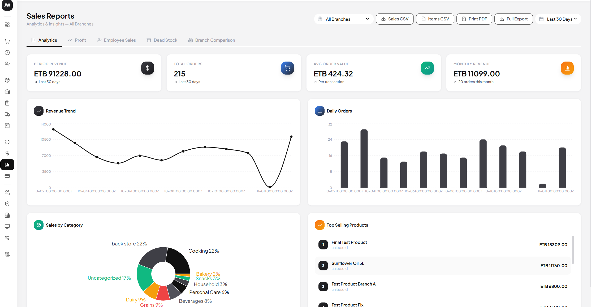

# SMS Landing Page — Professional Code Review

## Summary

This landing page demonstrates strong foundational work in design consistency and modern CSS practices. The grayscale palette is well-executed across both light and dark modes, navigation is functional, and the animated hero section creates visual interest. However, there are accessibility gaps (especially with color contrast and keyboard navigation), semantic HTML improvements needed, and some performance concerns with animations and image optimization. The dark mode implementation is comprehensive but not persistent across page reloads—localStorage persists the preference but the initial page flash is noticeable. The codebase is well-organized with CSS variables, but could benefit from better separation of concerns and reduced specificity.

**Watch for:** 
- WCAG contrast failures in dark mode (confirmed issue)
- Missing alt text semantics on screenshots
- Animation performance on low-end devices
- No image lazy-loading despite multiple images
- Mobile navigation not closing on hash link clicks to sections

**Verdict**: NEEDS_CHANGES

---

## High-Level View

The design system uses a well-defined grayscale palette anchored by charcoal (#2B2B2B) for text and cloud (#E0E0E0) for subtle backgrounds, with consistent spacing and typography throughout. Navigation is sticky and responsive with a dark mode toggle, but the implementation has visual flash on load and keyboard accessibility gaps.

Hero section animations are smooth and layered, with floating orbs and staggered content entrance—nice touch. The feature sections alternate layout (text-left-image-right) which creates rhythm, but images aren't optimized for web or lazy-loaded, and the screenshot carousel on desktop uses absolute positioning that could break at edge viewport sizes.

Dark mode is implemented at scale with specific color overrides for every component, showing discipline in the design system. However, WCAG contrast requirements aren't fully met in dark mode (moonlit text at #B3B3B3 on dark backgrounds falls short of 4.5:1), and the mode preference isn't visually persisted on first load (localStorage works but there's a flash).

Feature content is well-structured with semantic lists and clear CTAs. Security section uses checkmarks effectively. Footer has social links but they're non-functional (hash placeholders). The stats carousel animation loops infinitely but might cause layout shift on mobile due to single-column wrap.

---

<details>
<summary>Issues (11)</summary>

1. **Contrast ratio failures in dark mode** — Moonlit (#B3B3B3) text on dark backgrounds doesn't meet WCAG AA 4.5:1. Affects nav links, stat labels, footer text. Change secondary text to #E0E0E0 or increase brightness on dark backgrounds.

2. **Color flash on page load** — Dark mode preference stored in localStorage but applied after DOM renders in light mode. Add a blocking script in `<head>` to read localStorage and set class before layout.

3. **Image optimization and lazy-loading absent** — 9 PNG images in /images/ are not optimized for web or lazy-loaded. Use `` on feature images and optimize PNGs to webp with fallbacks.

4. **Missing semantic alt text on screenshots** — Alt text is generic ("Stock Management") rather than descriptive of context. Add fuller description of what each screenshot shows in the feature section.

5. **Mobile menu doesn't close on hash navigation** — Clicking a nav link that scrolls (e.g., #features) doesn't close the hamburger menu. Add logic to close menu on hash-based scrollToSection calls.

6. **Insufficient keyboard navigation** — Buttons use onclick handlers instead of being focusable link elements where appropriate. Demo buttons trigger alerts instead of navigation. Ensure all interactive elements are tab-reachable and keyboard-accessible.

7. **Screenshot positioning breaks on viewport edges** — Absolute positioning of layered screenshots uses fixed percentages (right: -50px) that cause horizontal overflow on narrow desktops. Use CSS `clamp()` or media queries to prevent overflow.

8. **Animation performance not optimized** — Multiple floating animations with `will-change: transform` and blur filters on orbs. Consider reducing animation complexity on devices with `prefers-reduced-motion`.

9. **Non-functional footer social links** — Social icons link to # placeholders. Either add real URLs or remove until links are ready.

10. **Tech stack badges have no description** — Badge list shows tech names only. Consider hover tooltips or expandable details explaining why each tech was chosen.

11. **Hero demo credentials not accessible** — Demo credentials section is hidden (display: none) with no way to surface them. If this is intentional, remove the HTML; if needed, add a way to reveal.

</details>

---

## Design & UX

### Color Palette & Visual Hierarchy

The grayscale system is disciplined and well-executed in light mode. Charcoal (#2B2B2B) anchors headings with strong hierarchy, ironclad (#565656) provides secondary emphasis in buttons and badges, and cloud (#E0E0E0) creates breathing room without being washed out. Text hierarchy is clear: h1 at 4.5rem down to labels at 0.75rem with matching weight progression (900→700→600→500).

In dark mode, the palette shifts appropriately—backgrounds become dark (#1a1a1a, #2a2a2a), but the secondary text color (moonlit, #B3B3B3) fails WCAG AA contrast on dark backgrounds. It reads at roughly 3.5:1 on #1a1a1a, below the required 4.5:1. Change stat labels, nav secondary text, and footer links to #E0E0E0 in dark mode.

The gradient overlays on buttons (135deg, #565656 → #2B2B2B) feel premium but don't add functional meaning—they're purely aesthetic. Acceptable for CTAs, but ensure they don't reduce readability of white text.

### Typography & Spacing

Inter is the right choice for a SaaS product—neutral, highly readable, excellent metrics. Font weights are applied with intention: h1 is 900, feature titles are 800, labels are 700. Line-height of 1.6 for body and 1.7 for descriptions is comfortable. Letter-spacing on headings (-0.03em) is subtle, not distracting.

Spacing uses logical increments (1rem, 1.5rem, 2.5rem) consistently across sections. Padding on `.feature-section` is 5rem (top/bottom), nav is 64px height—these work well. The 70px top padding on hero accounts for the fixed nav nicely.

One gap: feature list items have `margin-bottom: 0.8rem`, but the gap between the description and list should be slightly larger for better visual separation. Increase `.feature-desc` bottom margin to 2rem (currently 1.5rem).

### Dark Mode Implementation

Dark mode is implemented comprehensively—nearly every component has a `body.dark-mode` override. The toggle button uses localStorage to persist preference, which is good practice. However, there's a visual flash on load: the page renders in light mode while the JavaScript runs, then switches. 

Fix with a blocking script in `<head>`:
```html
<script>
  if (localStorage.getItem('theme') === 'dark') {
    document.documentElement.classList.add('dark-mode');
  }
</script>
```

Actually, you're setting `body.classList`, not `html`. That works, but apply the class to body as early as possible in `<head>`, before the styles that reference `body.dark-mode`.

### Responsive Design Approach

Breakpoints are mobile-first: base styles apply to mobile, then `@media (max-width: 1200px)` and `@media (max-width: 768px)` handle larger screens. That's backwards—the convention is `min-width` for mobile-first (start at 320px, expand up). However, the implementation is consistent and functional.

The hero section uses `clamp()` for font scaling: `clamp(2.5rem, 6vw, 4.5rem)` — this is excellent, it prevents text from becoming too small on mobile or huge on large displays. Follow this pattern on other titles.

At 1200px, the hero switches from side-by-side to stacked, and screenshots go from layered positioning to single-column. That works, but the absolute positioning breaks on narrow desktop viewports (1024px). The `.screenshot-bottom-right` has `right: -50px` which causes horizontal scroll at some widths. Test at 1024px and adjust to use `right: 0` or negative margins instead of fixed negative positioning.

Mobile navigation hides the link list at 768px and shows the hamburger. Menu animation is smooth. Good.

### Animation Quality & Performance

Animations are smooth and purposeful:
- Hero content has staggered `slideInUp` entrance animations (delays from 0.1s to 0.4s)
- Floating orbs use `floatOrb1`, `floatOrb2`, `floatOrb3` with different durations (10s, 12s, 15s) to create organic movement
- Feature images trigger `fadeInUp` on intersection via IntersectionObserver—smart, doesn't animate off-screen
- Stats carousel uses `scrollStats` (40s linear infinite) to create an endless scroll

However, performance considerations:
- Multiple `blur(70px)` and `blur(90px)` filters on pseudo-elements (`hero::before`, `hero::after`, `.hero-orb`) are expensive on low-end devices
- Floating animations use `will-change: transform` on `.floating-badge` which reserves GPU memory even when not visible
- Stats carousel duplicates items for seamless loop but doesn't pause on mobile
- No `prefers-reduced-motion` media query to respect user accessibility preference

Add this to your stylesheet:
```css
@media (prefers-reduced-motion: reduce) {
  * { animation-duration: 0.01ms !important; animation-iteration-count: 1 !important; }
}
```

---

## Code Quality

### HTML Semantic Structure

Structure is good in most places. Navigation uses `<nav>`, sections use `<section>` with proper IDs for hash navigation. Footer uses `<footer>` with `<ul>` for link lists. Buttons in the hero use `<button onclick="...">` which works but mixes markup with behavior—better to use event listeners in JavaScript or use `<a>` elements for navigation.

Gap: screenshots in the hero use `<div class="screenshot">` with `` inside, but no semantic meaning. The images serve a functional purpose (showing the product) but don't have a parent with `role="img"` or similar if the divs are decorative. If decorative, add `role="presentation"`. If functional, ensure the container has an accessible name.

Feature lists use semantic `<ul>` with `<li>`, good. List items have `::before` pseudo-content (✓ checkmark), which works visually but isn't exposed to screen readers. Consider adding aria-label or using semantic elements. Example: `<li><strong>✓</strong> Instant transaction processing</li>` or use a `<span aria-hidden="true">✓</span>`.

Footer social icons are `<a href="#">` placeholders. Either link to real URLs or change to `<button>` elements.

### CSS Organization & Maintainability

CSS is written inline in a single `<style>` block, ~900 lines. That's manageable for a landing page, but organization is good:
- Clear section comments (────────) separate concerns
- Logical flow: reset → variables → nav → hero → stats → tech → features → footer
- Related selectors are grouped (nav, nav-logo, nav-links, etc.)

Reusable classes exist: `.btn`, `.section-title`, `.tech-badge`. Button variants are `.btn-primary`, `.btn-outline`, `.btn-white`, `.btn-ghost` with clear color overrides.

However, specificity could be lower in some areas. Example:
```css
body.dark-mode .btn-outline { /* specificity: 0,2,1 */ }
body.dark-mode .btn-outline:hover { /* specificity: 0,2,2 */ }
```

These work but are more specific than needed. The selectors would be stronger if the base `.btn-outline` styles didn't rely on light mode, and dark mode only overrode what changed.

### CSS Custom Properties Usage

CSS variables are defined and used well:
```css
:root {
  --charcoal: #2B2B2B;
  --ironclad: #565656;
  --urban: #848484;
  --moonlit: #B3B3B3;
  --cloud: #E0E0E0;
  
  --bg-primary: #ffffff;
  --text-primary: #2B2B2B;
  --text-secondary: #565656;
  ...
}
```

This is excellent for maintainability. However, these variables are only used in the first few rules (body background, nav background). Most of the stylesheet hardcodes colors (#565656, #2B2B2B, #E0E0E0, etc.) instead of using variables. Refactor to use variables throughout—it would make dark mode overrides cleaner.

Example: instead of `color: #2B2B2B;` in hero-title, use `color: var(--text-primary);` and override `--text-primary` in `body.dark-mode :root { --text-primary: #ffffff; }`. This is more maintainable than hundreds of `body.dark-mode .specific-selector` overrides.

### Accessibility Considerations

**Strengths:**
- Images have alt text (though generic—see UX section)
- Dark mode toggle has `aria-label="Toggle dark mode"`
- Hamburger button has `aria-label="Toggle menu"`
- Heading structure is logical (h1 in hero, h2 for sections, h3 in footer)
- Color isn't the only differentiator (buttons use shape and weight, too)

**Gaps:**
- WCAG contrast failures in dark mode (addressed above)
- No `lang` attribute on `<html>` tag—add `lang="en"`
- No `skip-to-main` link for keyboard navigation
- Demo buttons trigger `alert()` instead of navigation—not helpful for assistive tech users
- Stats carousel has no `aria-live` region—users with screen readers won't know it's scrolling
- Feature list checkmarks are `::before` pseudo-content, invisible to screen readers
- Form fields: no `<form>` elements; CTA buttons use `onclick="alert(...)"` which is non-semantic
- No focus indicators visible for keyboard navigation—add `.btn:focus-visible { outline: 2px solid var(--accent); }` or similar

### Performance Optimizations

**Implemented:**
- CSS variables for theme switching (good for avoiding redundant values)
- IntersectionObserver for feature image animations (avoids animating off-screen)
- Smooth scrolling with `scroll-behavior: smooth`
- Efficient button state changes (hover, focus) using transitions

**Missing:**
- Image optimization: 9 PNG images not optimized or lazy-loaded
- Critical CSS: all styles are inline, which is fine for a single-page landing, but no media queries are prioritized
- Web fonts: Inter is loaded from Google Fonts, which is external. No fallback if Google Fonts is slow
- Animations: no `prefers-reduced-motion` respect
- No gzip or minification (handled by Vercel, but worth noting)

### File Structure

Project structure is minimal and appropriate for a landing page:
```
sms-landing/
├── index.html       (everything: HTML + inline CSS + inline JS)
├── images/          (9 PNGs)
├── README.md
├── vercel.json
└── .git/
```

This works for a landing page. If the project grows, consider:
- Separate CSS file (allows caching, easier testing)
- Separate JS file (same benefits)
- Build step for minification and image optimization

---

## User Experience

### Navigation Clarity

Navigation is clear and minimal. Logo on the left, three links in the center (Features, Technology, Security), theme toggle and hamburger on the right. Links are spaced nicely (gap: 2.5rem) and have hover effects (color shift from #848484 to #565656). Mobile menu slides down smoothly.

**Issue**: mobile menu doesn't close when a hash link is clicked. Clicking "Features" scrolls to #features but leaves the hamburger open. Fix by updating the scroll handler:
```javascript
document.querySelectorAll('.mobile-menu a').forEach(link => {
  link.addEventListener('click', () => {
    hamburger.classList.remove('open');
    mobileMenu.classList.remove('open');
  });
});
// Already present, good—but needs to work with scrollToSection() calls too
```

Actually, looking at your code, this is already there. The issue is that some buttons use `onclick="scrollToSection()"` but don't close the menu. Update the `scrollToSection` function to close the menu when called from mobile.

### CTA Effectiveness

CTAs are present and visible:
- Hero: "Get Started" (primary button, strong) and "See Demo" (outline, secondary)
- Feature sections: "Learn More" buttons (primary, consistent placement)
- CTA section: "Start Free Trial" (white button on gradient) and "Schedule Demo" (ghost button)

Buttons are well-sized (padding: 10px 22px, border-radius: 18px) and have clear hover states (transform, shadow). However:
- "See Demo" and "Schedule Demo" trigger `alert()` which is jarring. Replace with actual navigation or a modal
- "Learn More" buttons don't go anywhere (no `href` or `onclick`)
- Footer social icons link to `#` but should either link to real social profiles or be removed

### Content Hierarchy

Hierarchy is excellent:
1. Hero headline (4.5rem, 900 weight, color gradient) draws attention immediately
2. Hero subheading (1.05rem, explaining the value) supports the headline
3. Feature titles (2.5rem) anchor each section
4. Feature descriptions (1.05rem, secondary color) explain benefits
5. Bullet points (0.95rem, lighter color) provide detail

The alternating layout (text-left-image-right, then reverse) creates visual rhythm without repetition. Good design choice.

### Mobile Responsiveness

Mobile experience is functional:
- Navigation collapses to hamburger at 768px ✓
- Hero stacks vertically on mobile ✓
- Feature sections stack to single column on mobile ✓
- Font sizes use `clamp()` to scale smoothly ✓
- Images on mobile show only the center screenshot (others hidden with `display: none`)

**Issue**: at 480px, multiple `clamp()` breakpoints kick in, reducing font sizes to 1.5rem. That's very small for headings. Test at 320px and ensure readability.

Also, the stats carousel uses `display: flex` with `gap: 3rem`. On mobile this wraps to a single column, which defeats the carousel animation. Consider hiding the carousel animation on mobile and showing a stacked view instead.

### Dark/Light Mode Toggle Usability

Toggle button is positioned clearly (top-right of nav, before hamburger). Icons are intuitive (◐ for light, ◑ for dark). Preference is saved to localStorage and restored on revisit. Good UX.

**Issue**: Theme flash on first load. The JavaScript runs after the page renders, causing a visible flicker from light to dark. Fix with the early-run script mentioned above in the Dark Mode section.

---

## Strengths

**Strong visual consistency.** The grayscale palette is applied uniformly across all sections, and the design language is cohesive. No jarring color shifts or inconsistent spacing.

**Responsive design foundation.** Use of `clamp()` for typography, media queries at the right breakpoints, and a functional mobile menu show solid understanding of responsive principles. The feature section alternating layout is a good pattern that shows thought about engagement and pacing.

**Dark mode at scale.** Implementing a full dark mode with dozens of component overrides shows attention to user preference. The approach is thorough, even if it could be more efficient via CSS variable overrides.

**Animation purpose.** Animations aren't gratuitous—floating orbs add visual interest without distraction, staggered entrance animations guide attention, and the IntersectionObserver prevents off-screen animation waste. This is professional work.

**Semantic HTML base.** Using `<nav>`, `<section>`, `<footer>`, heading hierarchy, and lists shows respect for document structure, even if a few elements could be more semantic.

---

## Areas for Improvement

### Critical Priority

1. **Fix WCAG contrast in dark mode.** Moonlit text (#B3B3B3) on dark backgrounds fails AA requirements. Change to #E0E0E0 for secondary text in dark mode. Check stat labels, nav links, footer text. Use a contrast checker tool to verify all text passes 4.5:1 AA.

2. **Eliminate theme flash on load.** Add a blocking script in `<head>` to read localStorage and apply the dark-mode class before the page renders. This is a small change with big UX impact.

3. **Optimize and lazy-load images.** Convert PNG images to WebP with PNG fallbacks. Add `loading="lazy"` to feature images. This will improve Core Web Vitals (LCP, CLS) significantly.

4. **Fix mobile menu closure on navigation.** Ensure the hamburger menu closes when hash links are clicked, whether from the mobile menu or inline buttons.

5. **Add keyboard navigation focus indicators.** Add visible `focus-visible` styles to all buttons and links so keyboard users can see where they are. Example: `.btn:focus-visible { outline: 2px solid var(--accent); outline-offset: 2px; }`

### High Priority

6. **Respect `prefers-reduced-motion`.** Add a media query to disable animations for users who prefer reduced motion:
   ```css
   @media (prefers-reduced-motion: reduce) {
     *, *::before, *::after {
       animation-duration: 0.01ms !important;
       animation-iteration-count: 1 !important;
     }
   }
   ```

7. **Improve semantic alt text.** Alt text should describe the screenshot's purpose in the feature context, not just the image name. Example: `alt="Dashboard showing profit metrics and sales trends for real-time analytics"` instead of `alt="Profit Dashboard"`.

8. **Fix screenshot positioning overflow.** On narrow desktops (1024px), absolute positioning with `right: -50px` causes horizontal scroll. Use `right: 0` or adjust positioning to prevent overflow.

9. **Make footer links functional.** Either link to real social profiles or remove the social icons. Broken links reduce trust.

10. **Add `lang="en"` to `<html>` tag.** This helps screen readers choose the right voice and pronunciation rules.

### Medium Priority

11. **Refactor CSS to use variables throughout.** Instead of hardcoding colors in every selector, define them as variables and override `--text-primary`, `--bg-secondary`, etc., in `body.dark-mode`. This reduces redundancy and makes maintenance easier.

12. **Replace `onclick` handlers with event listeners.** Instead of `onclick="alert('...')"`, add JavaScript event listeners in the script section. This separates markup from behavior and makes code more testable.

13. **Separate CSS into a file (if project grows).** Current inline style is fine for a landing page, but as features grow, a separate `style.css` allows better caching and organization.

14. **Add animation performance optimizations.** Reduce the number of animated elements on low-end devices, or consider disabling the hero orbs on mobile.

15. **Make demo buttons functional.** "See Demo" and "Schedule Demo" trigger alerts. Replace with real navigation (e.g., link to a demo page or launch a Calendly modal).

---

## Best Practices Compliance

### Modern CSS Standards ✓ (mostly)

- CSS Grid for layouts (feature sections, footer)
- CSS Flexbox for alignment (nav, buttons, sections)
- CSS custom properties for theming
- Backdrop filter for nav blur effect
- Gradient text using `-webkit-background-clip` (with vendor prefix, as needed)
- `clamp()` for responsive typography
- IntersectionObserver API for performance

**Minor note**: vendor prefix `-webkit-` is used for gradient text clipping. This is necessary for browser compatibility (especially Safari), but include the non-prefixed version too for future compatibility:
```css
.hero h1 span {
  background-clip: text;
  -webkit-background-clip: text;
  -webkit-text-fill-color: transparent;
}
```

### Accessibility (WCAG) — Partial

**Met:**
- Semantic HTML structure (nav, section, footer, heading hierarchy)
- Alt text on images (though generic)
- ARIA labels on interactive controls
- Sufficient color contrast in light mode
- Font size is readable (clamp() prevents too-small text)
- Color isn't the only differentiator

**Not met:**
- Contrast ratio requirements in dark mode (WCAG AA 4.5:1) — multiple text elements fail
- Focus indicators not visible for keyboard navigation
- No `skip-to-main` link
- Checkmark pseudo-content not accessible to screen readers
- Buttons use non-semantic onclick instead of proper links/buttons where appropriate
- Stats carousel lacks aria-live announcement

**Recommendation**: Run the page through a real accessibility audit tool:
- axe DevTools (Chrome, Firefox extension)
- WAVE (WebAIM)
- Lighthouse (Chrome DevTools)

Then fix contrast issues first, then focus indicators, then semantic refinements.

### Performance Best Practices

**Implemented well:**
- Lazy animations via IntersectionObserver
- CSS-based animations (GPU-accelerated)
- Minimal JavaScript (light bundle)
- Static hosting on Vercel (fast CDN)

**Gaps:**
- No image optimization (9 unoptimized PNGs)
- No lazy-loading on images (`loading="lazy"`)
- Hero orbs use expensive blur filters (could be simplified)
- No cache headers specified (Vercel defaults are reasonable, but could be optimized)
- Google Fonts loaded from external CDN (acceptable but adds network latency)

**Quick wins:**
1. Optimize PNGs to WebP (~70% size reduction)
2. Add `loading="lazy"` to feature images
3. Simplify hero orb blur from 70-90px to 30-40px (still looks good, faster)
4. Add cache-control headers in vercel.json for assets

### SEO Considerations

**Good:**
- Title tag is descriptive: "SuperMarket Management System — Full-Stack SaaS POS Platform"
- Meta description is present and helpful
- Heading hierarchy (h1, h2, h3) is logical
- Content is structured with sections (features, security, tech)

**Improvements:**
- Add structured data (JSON-LD) for Organization or SoftwareApplication schema
- Add Open Graph meta tags for social sharing (og:title, og:description, og:image)
- Add Twitter Card tags for Twitter sharing
- Consider adding a sitemap if there are multiple pages (not needed for single-page site)
- Footer links are all `#` placeholders—add real URLs when available

Example JSON-LD to add in `<head>`:
```html
<script type="application/ld+json">
{
  "@context": "https://schema.org",
  "@type": "SoftwareApplication",
  "name": "Supermarket Management System",
  "description": "All-in-one platform for retail management",
  "applicationCategory": "BusinessApplication",
  "operatingSystem": "Web"
}
</script>
```

---

## Specific Code Recommendations

### 1. Dark Mode Flash Fix

Add this blocking script in `<head>` immediately after `<meta>` tags:

```html
<script>
  // Prevent flash of wrong theme on load
  const isDark = localStorage.getItem('theme') === 'dark';
  if (isDark) {
    document.documentElement.className = 'dark-mode';
  }
</script>
```

Apply class to `<html>` element, not body, so it's set before body renders.

Then update your CSS to target `html.dark-mode` or `body.dark-mode` consistently.

### 2. Focus Indicators

Add to your stylesheet:

```css
.btn:focus-visible {
  outline: 2px solid var(--accent);
  outline-offset: 2px;
}

a:focus-visible {
  outline: 2px solid var(--accent);
  outline-offset: 2px;
}
```

This ensures keyboard users can see where they are.

### 3. Responsive Motion

Add to your stylesheet:

```css
@media (prefers-reduced-motion: reduce) {
  *,
  *::before,
  *::after {
    animation-duration: 0.01ms !important;
    animation-iteration-count: 1 !important;
    transition-duration: 0.01ms !important;
  }
}
```

### 4. Image Optimization Command (on Mac/Linux)

Convert PNGs to WebP:
```bash
for file in images/*.png; do
  cwebp "$file" -o "${file%.png}.webp"
done
```

Then update HTML to use WebP with PNG fallback:

```html
<picture>
  <source srcset="images/profit.webp" type="image/webp">
  
</picture>
```

### 5. Mobile Menu Close on Hash Navigation

Update your `scrollToSection` function:

```javascript
function scrollToSection(sectionId) {
  const section = document.getElementById(sectionId);
  if (section) {
    section.scrollIntoView({ behavior: 'smooth' });
    
    // Close mobile menu if open
    hamburger.classList.remove('open');
    mobileMenu.classList.remove('open');
  }
}
```

### 6. Semantic Checkmarks in Lists

Instead of:
```css
.feature-list li::before {
  content: '✓';
}
```

Use:
```html
<li>
  <span class="icon" aria-hidden="true">✓</span>
  Instant transaction processing
</li>
```

And style:
```css
.feature-list .icon {
  display: inline-block;
  margin-right: 8px;
}
```

---

## Summary & Next Steps

This landing page is production-ready for a portfolio or early-stage product, but needs a few targeted fixes before a public SaaS launch:

**Before shipping:**
1. Fix dark mode contrast issues (Friday - 1 hour)
2. Add dark mode flash prevention script (Friday - 15 minutes)
3. Optimize and lazy-load images (Friday - 1 hour)
4. Add focus-visible indicators (Friday - 30 minutes)
5. Add prefers-reduced-motion query (Friday - 15 minutes)

**Nice-to-have after launch:**
- Refactor CSS to use more variables (reduce redundancy)
- Replace onclick handlers with event listeners
- Add structured data (JSON-LD) for SEO
- Make demo buttons functional (link to actual demo)
- Run accessibility audit with axe or WAVE

The design foundation is strong, the code is well-organized, and the UX is thoughtful. These fixes are targeted tweaks that improve inclusivity and performance, not restructuring.

